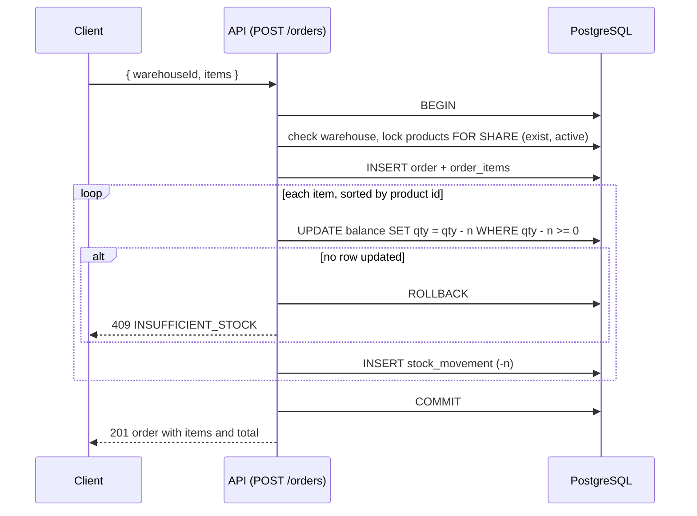

# Architecture

```text
Client (curl, Swagger UI at /docs, examples/demo.http)
   │  JSON over HTTP; writes carry x-api-key
   ▼
Fastify routes (src/routes)      ── TypeBox schemas: validation, response shape, OpenAPI
   │
   ▼
Services (src/services)          ── business rules; one transaction per write
   │  move() is the only code that changes stock
   ▼
PostgreSQL 16                    ── CHECK quantity >= 0, unique SKU/reference, append-only ledger trigger
```

## Order flow



## Why there is no repository layer
Services own their SQL. Each query is used in one place, and a repository interface would have exactly
one implementation. `src/db/pool.ts` holds the shared persistence pieces: the pool, `tx()` and `paged()`.
